# TFG DevSecOps Pipeline

Pipeline de CI/CD seguro, reutilizable vía `workflow_call` de GitHub Actions,
desarrollado como parte del Trabajo Final de Grado *"Diseño e implementación
de un pipeline CI/CD seguro aplicando prácticas DevSecOps"*.

Este repositorio **es el objeto de estudio del TFG** — el pipeline en sí, con
sus propios requisitos y arquitectura — separado de la aplicación de ejemplo
sobre la que se demuestra
([`Disney-Plus-Clone`](https://github.com/Rosten1805/Disney-Plus-Clone)),
que simplemente lo invoca.

Realizado por **Cristina Cañadas Gómez-Limón** — [cristinagomez-limon.com](https://cristinagomez-limon.com)

## Cómo se usa

Cualquier repo que quiera aplicar este pipeline añade un workflow mínimo que
lo invoca:

```yaml
name: Security Pipeline

on:
  pull_request:
    branches: [main]
  push:
    branches: [main]

jobs:
  call-pipeline:
    uses: Rosten1805/tfg-devsecops-pipeline/.github/workflows/security-pipeline.yml@main
    secrets: inherit
```

## Etapas

| Etapa | Herramienta | Estado |
|---|---|---|
| SAST | Semgrep + Checkov + SonarQube Cloud | Implementado |
| SCA | npm audit + Dependabot | Implementado |
| Escaneo de imagen | Trivy | Implementado |
| DAST | OWASP ZAP (baseline) | Implementado |
| IaC / despliegue | Terraform (AWS) | Implementado |
| Monitorización | CloudWatch Alarms + SNS | Implementado |

## Flujo del pipeline paso a paso

El workflow (`security-pipeline.yml`) encadena cinco jobs con dependencias
explícitas (`needs:`), de forma que cada uno solo arranca si el anterior ha
terminado bien. En una *pull request* solo se ejecutan los tres primeros
(nunca se despliega nada); al fusionar a `main` se ejecuta la cadena
completa, incluido el despliegue.

```
sast ─┐
sca  ─┴─► build-and-scan ─► dast ─► deploy
```

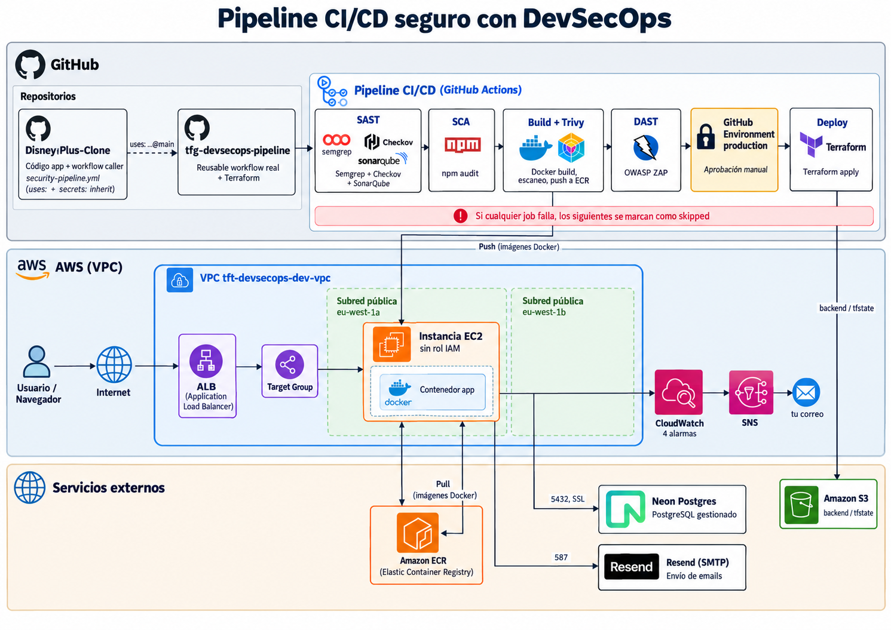

### 1. `sast` — SAST (Semgrep + Checkov + SonarQube Cloud)

- **Semgrep** analiza el código con los sets públicos (`p/javascript`,
  `p/typescript`, `p/react`, `p/nextjs`, `p/secrets`, `p/sql-injection`) más
  dos reglas propias (`.semgrep/custom-rules.yml`) escritas para detectar
  patrones que las reglas genéricas no cubrían: inyección SQL vía plantilla
  literal y un secreto con valor de respaldo hardcodeado. Se ejecuta con
  `--error`, para que un hallazgo bloqueante haga fallar el job (sin ese
  flag, `semgrep scan` no cambia el código de salida).
- **Checkov** analiza el `Dockerfile` en busca de malas prácticas.
- **SonarQube Cloud** añade métricas de calidad (duplicación,
  mantenibilidad) y su propio quality gate, autenticado con el secret
  `SONAR_TOKEN`.
- Checkov y SonarQube se ejecutan con `if: ${{ !cancelled() }}`, así que
  corren igualmente aunque Semgrep ya haya fallado: las tres herramientas
  siempre terminan de reportar en la misma ejecución.

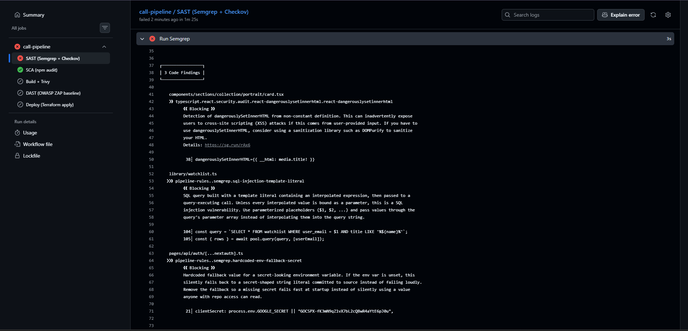
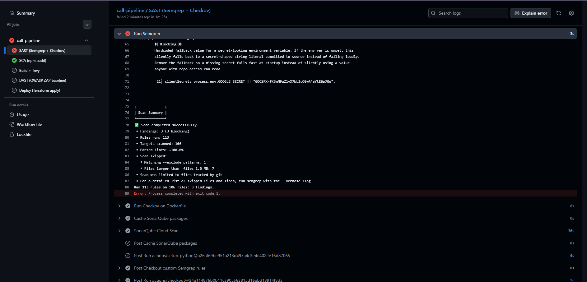
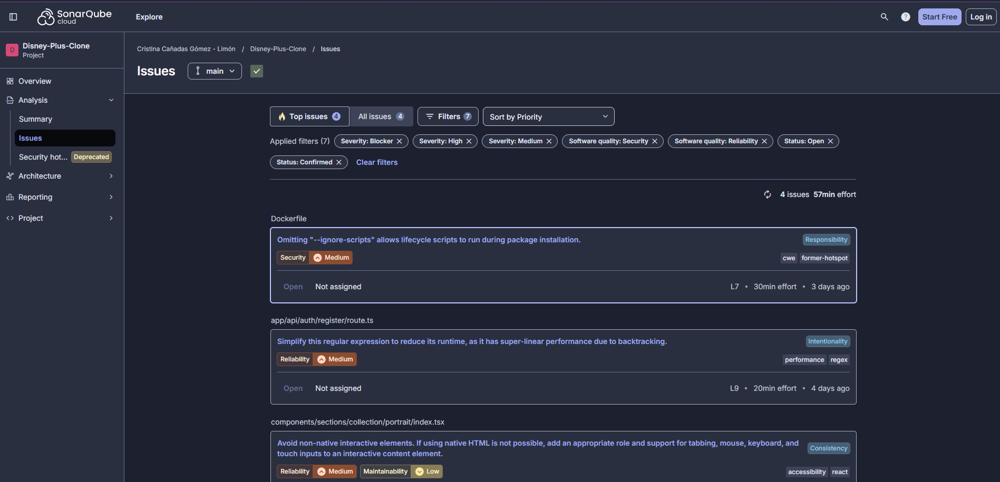

### 2. `sca` — SCA (npm audit)

`npm audit --audit-level=high` bloquea el job si hay dependencias
declaradas con vulnerabilidades de severidad alta o crítica. Se complementa
con Dependabot (`.github/dependabot.yml`), que vigila el repo de forma
continua, no solo en cada ejecución del pipeline, y que también revisa las
propias GitHub Actions usadas en el workflow.

### 3. `build-and-scan` — Build + Trivy

Depende de `sast` y `sca`. Construye la imagen Docker (secretos de build
pasados con `docker build --secret`, nunca como `--build-arg`, para que no
queden grabados en ninguna capa) y la escanea con **Trivy** dos veces:

1. Un informe completo (todas las severidades) que no bloquea, solo para
   dejar constancia.
2. Un segundo escaneo que sí actúa como *gate*: falla únicamente ante
   vulnerabilidades `CRITICAL`/`HIGH` que además tengan corrección
   disponible (`--ignore-unfixed`), para no bloquear indefinidamente por una
   CVE del sistema base sin parche.

Si todo pasa y la rama es `main`, la imagen se publica en Amazon ECR
etiquetada con el SHA del commit.

### 4. `dast` — DAST (OWASP ZAP baseline)

Depende de `build-and-scan` y solo se ejecuta en `main`. Descarga la imagen
recién publicada, la arranca en el propio runner, espera a que
`/api/health` responda y lanza **OWASP ZAP** en modo *baseline* (rastreo
pasivo, sin payloads de ataque activo) contra las páginas públicas. El
archivo `.zap/rules.tsv` decide qué hallazgos bloquean (`FAIL`), cuáles son
solo aviso (`WARN`) y cuáles se ignoran; se ejecuta con `cmd_options: "-I"`
para que únicamente las reglas marcadas `FAIL` hagan fallar el job (sin
`-I`, ZAP falla ante cualquier alerta, incluidas las `WARN`).

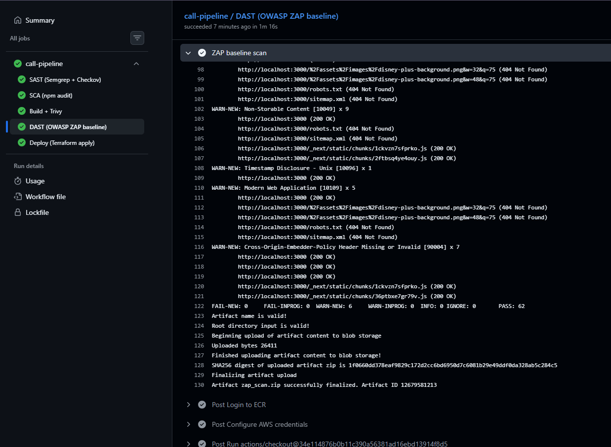

### 5. `deploy` — Deploy (Terraform apply)

Depende de `dast` y está asociado a un *Environment* de GitHub llamado
`production` con un revisor obligatorio: la ejecución se pausa ahí hasta
que alguien la aprueba manualmente, y ese paso de aprobación ni siquiera
llega a solicitarse si cualquier job anterior ha fallado. Al aprobarse,
aplica la infraestructura de `terraform/` (ver más abajo) usando el SHA del
commit como etiqueta de la imagen a desplegar.

La cadena de dependencias se verificó también de forma no buscada: en la
primera fusión real del código a `main`, el SAST falló (por las
vulnerabilidades intencionadas de la app de ejemplo) y el resto de jobs,
incluido el despliegue, se marcaron como *skipped* sin llegar siquiera a
solicitar la aprobación manual.

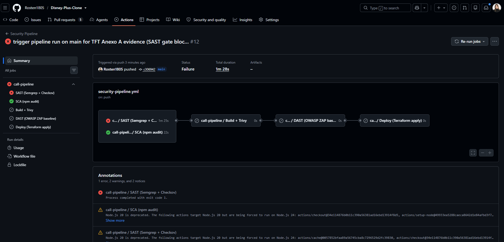

### Apagado manual (`teardown.yml`)

Workflow independiente, disparado solo a mano (`workflow_dispatch`, con un
input de confirmación literal `"destroy"`), que ejecuta `terraform destroy`
sobre la misma infraestructura. Usa el mismo *Environment* `production`
protegido por aprobación manual que el despliegue, para que apagar la
infraestructura no sea más sencillo de ejecutar por error que desplegarla.

## Infraestructura (Terraform)

`terraform/` se organiza en un `bootstrap/` (crea el bucket S3 del estado
remoto, con bloqueo nativo de S3) y cinco módulos en `modules/`:

- **networking** — VPC con subredes exclusivamente públicas (sin NAT
  Gateway ni subredes privadas).
- **ecr** — repositorio privado de Elastic Container Registry, con scanning
  automático habilitado.
- **alb** — balanceador de carga como único punto de entrada expuesto;
  reglas de *security group* que restringen el tráfico a la instancia
  exclusivamente desde el propio ALB.
- **ec2** — instancia EC2 sin rol de IAM (restricción real de permisos de
  la cuenta usada, documentada en el TFG) que ejecuta el contenedor de la
  aplicación.
- **monitoring** — cuatro alarmas de CloudWatch (CPU y estado de la
  instancia; errores 5xx y hosts no saludables del balanceador) que
  notifican por correo vía un topic de SNS.

Las credenciales y secretos de la aplicación (`NEXTAUTH_SECRET`,
`GOOGLE_SECRET`, `DATABASE_URL`, `TMDB_API_KEY`, credenciales SMTP de
Resend, etc.) se pasan como variables de Terraform marcadas `sensitive`,
nunca con valores por defecto.

<details>
<summary>Infraestructura desplegada en AWS (capturas)</summary>

| | |
|---|---|
| 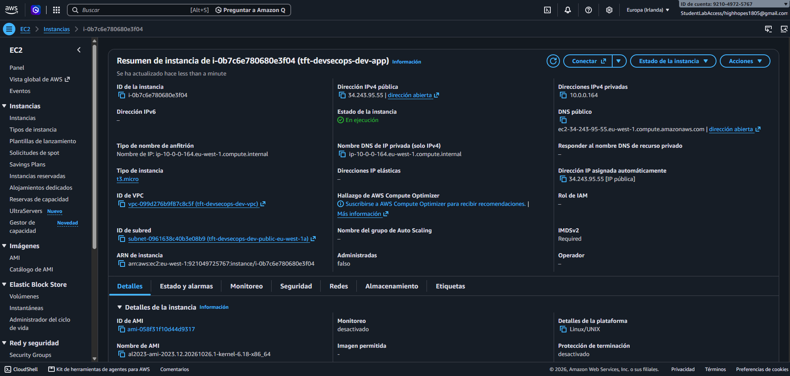 | 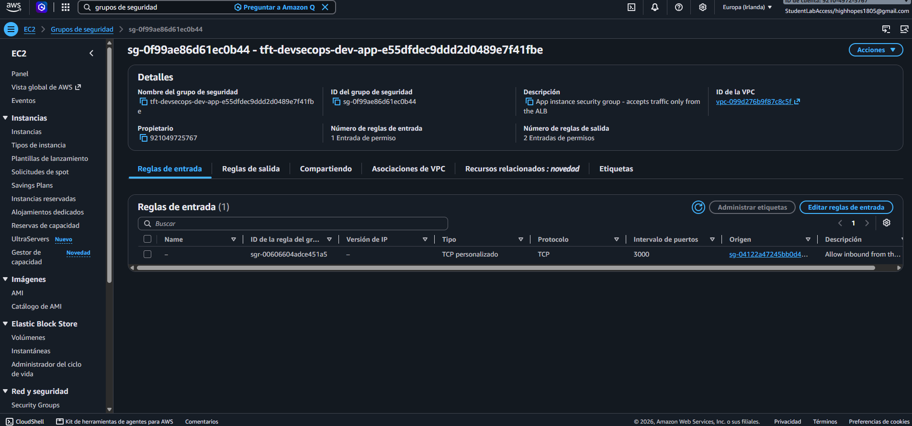 |
| Instancia EC2 de la aplicación, sin rol de IAM asociado | Reglas de entrada del security group (solo desde el ALB) |
| 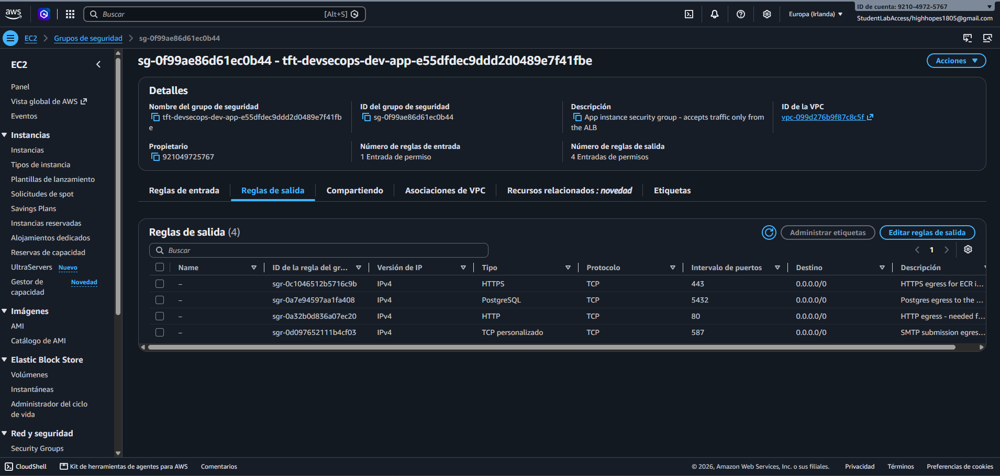 | 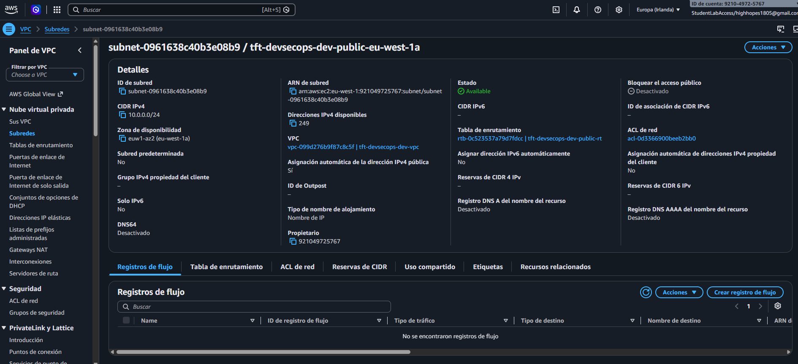 |
| Reglas de salida (HTTP, HTTPS, Postgres a Neon, SMTP a Resend) | Subred pública de la VPC |
| 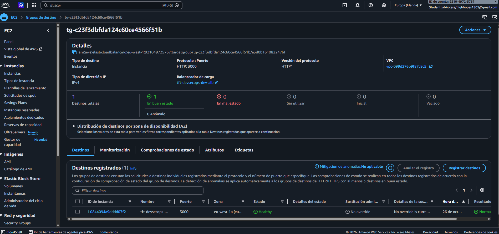 | 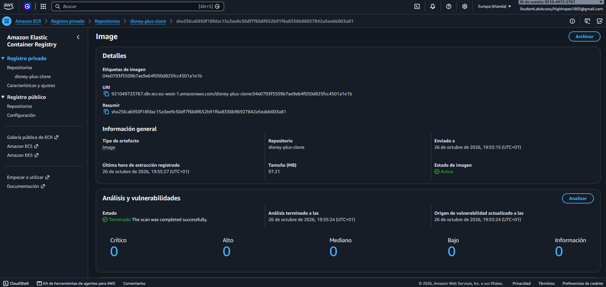 |
| Target group del ALB con la instancia en estado *healthy* | Resultado del escaneo de Trivy/ECR (0 críticas/altas/medias/bajas) |
| 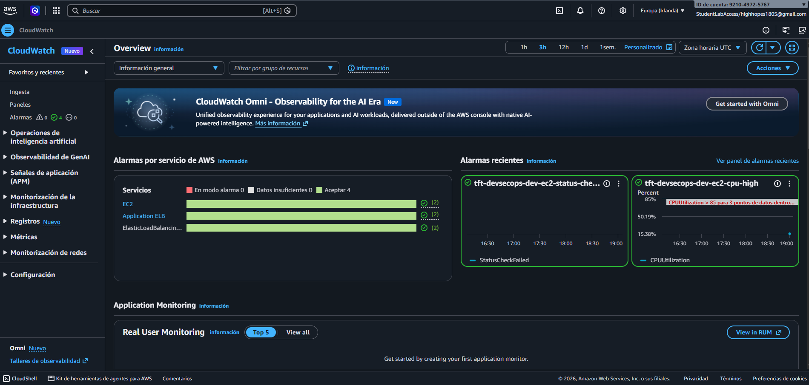 | 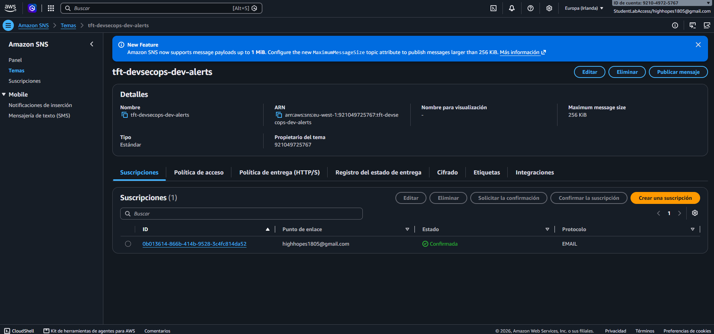 |
| Las 4 alarmas de CloudWatch en estado OK | Suscripción de SNS confirmada para las alertas por correo |
| 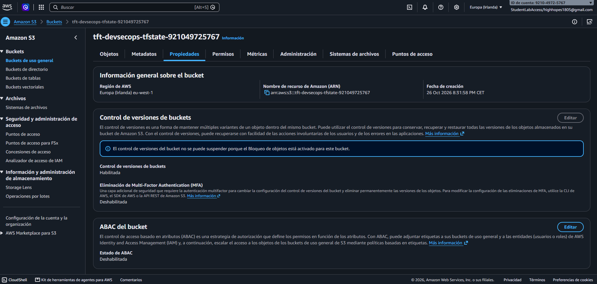 | 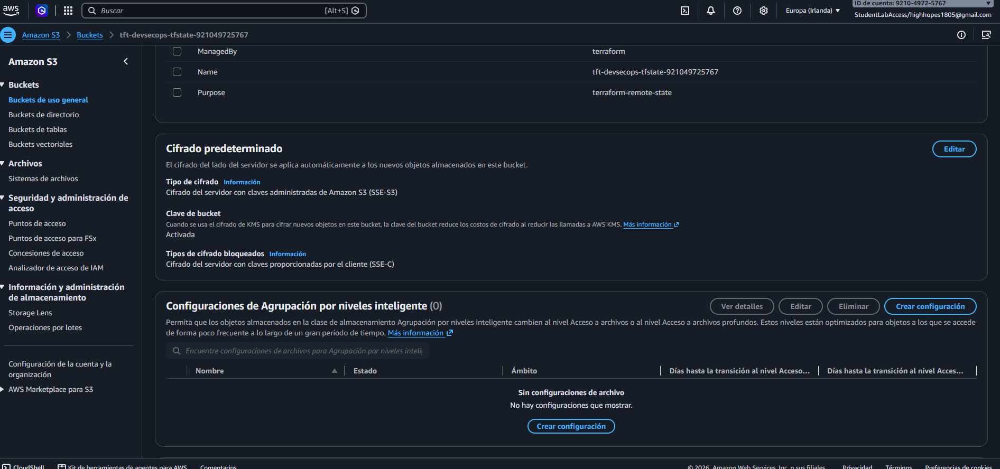 |
| Versionado habilitado en el bucket del estado de Terraform | Cifrado SSE-S3 habilitado en el mismo bucket |

</details>

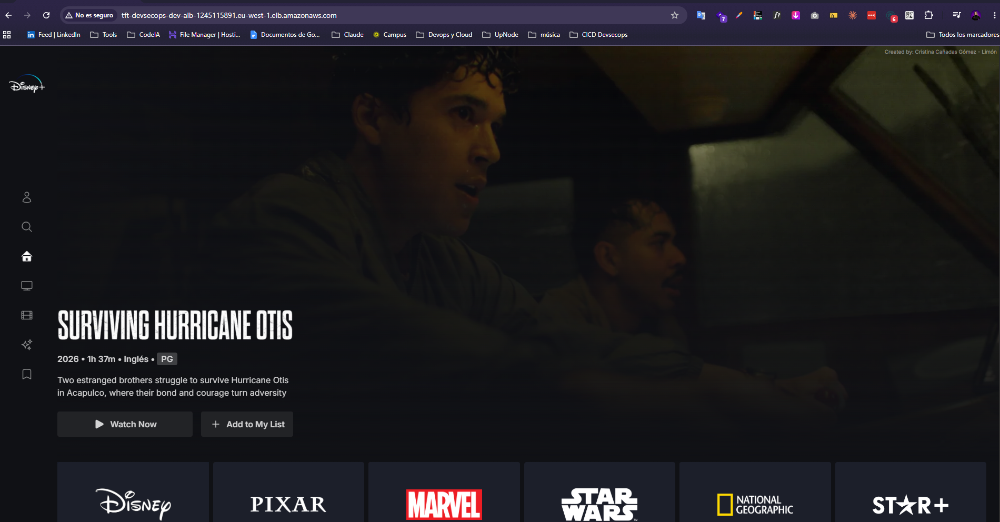

## Seguridad de la cadena de suministro del propio pipeline

Todas las *actions* de terceros están fijadas por hash de commit completo
(no por etiqueta de versión como `@v4`), para que no puedan apuntar
silenciosamente a un commit distinto del original. Dependabot está
configurado también para el ecosistema `github-actions`, así que las
actualizaciones se siguen proponiendo mediante *pull requests* aunque las
versiones estén fijadas por hash.

---

Ver el desarrollo completo, las decisiones de arquitectura y su
justificación, y los resultados obtenidos (incluida la primera ejecución
real en `main`, con el despliegue bloqueado por el SAST) en la memoria del
TFG.
